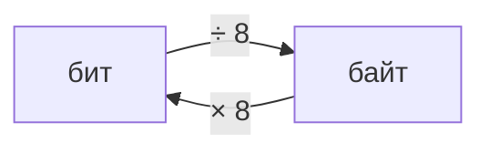

# Задание 1. Количественные параметры информационных объектов

## Краткая теория

**Бит** — маленькая единица информации. 8 бит составляют 1 байт. В задаче указано, сколько бит занимает один символ: при 8 битах символ занимает 1 байт, при 16 битах — 2 байта.

## Как решать

1. Найди, сколько байтов занимает один символ.
2. Раздели уменьшение размера текста на это число — получится количество удалённых символов.
3. Вычти два символа-разделителя: запятую и пробел.
4. Посчитай буквы в названиях списка и выбери слово нужной длины.

**Длина названия = уменьшение размера в байтах ÷ байтов на символ − 2.**

## Пример: 8-битная кодировка

[Задание № 10313](https://inf-oge.sdamgia.ru/problem?id=10313). В тексте перечислены реки; из списка убрали одну реку вместе с лишними запятой и пробелом. При кодировке КОИ-8 размер текста уменьшился на 8 байтов. Определи удалённое название:

«Обь, Лена, Волга, Москва, Макензи, Амазонка — реки».

**Разбор.** Один символ занимает 1 байт, значит удалено 8 символов. Два символа — запятая и пробел, поэтому на название остаётся 8 − 2 = 6 букв. Подходит «Москва».

**Ответ: Москва.**

## Пример: 16-битная кодировка

[Задание № 10238](https://inf-oge.sdamgia.ru/problem?id=10238). Из списка диких животных удалили одно название и необходимые разделители. Каждый символ кодируется 16 битами, а размер текста уменьшился на 16 байт. Определи название:

«еж, лев, слон, олень, тюлень, носорог, крокодил, аллигатор — дикие животные».

**Разбор.** Один символ занимает 2 байта, значит удалено 16 ÷ 2 = 8 символов. После вычитания запятой и пробела на название остаётся 6 букв. Подходит «тюлень».

**Ответ: тюлень.**

---
