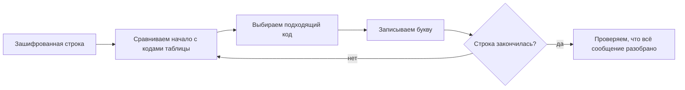

# Задание 2. Кодирование и декодирование

## Краткая теория

Код — это условное обозначение буквы или другого символа. Чтобы расшифровать сообщение, разбивай его на фрагменты, которые совпадают с кодами из таблицы. Если разделителей нет, проверяй варианты разбиения целиком: кодовая последовательность может делиться неоднозначно.

## Шифр из символов

**Пример задания** ([№ 37187](https://inf-oge.sdamgia.ru/problem?id=37187))

В таблице ниже каждой букве соответствует цепочка знаков:

| Буква | А | Е | Л | П | Т | О |
|---|---|---|---|---|---|---|
| Код | `+#` | `#+` | `~` | `#` | `+~#` | `~#` |

Получена строка `#~#~#++~#`. В ней закодированы неповторяющиеся буквы. Определите исходное сообщение.

**Решение.** Разбираем строку по кодам таблицы: `#` = П, `~#` = О, `~` = Л, `#+` = Е, `+~#` = Т. Получаем **ПОЛЕТ**.

**Ответ: ПОЛЕТ.** Такое разбиение дано в опубликованном решении.

## Шифр из цифр с неоднозначным чтением

**Пример задания** ([№ 4717](https://inf-oge.sdamgia.ru/problem?id=4717))

Для записи слова каждому символу присваивается двоичный код:

| Буква | А | В | Д | О | Р | У |
|---|---:|---:|---:|---:|---:|---:|
| Код | 01 | 011 | 100 | 111 | 010 | 001 |

Поскольку коды имеют разную длину, одна строка иногда допускает несколько разбиений. Проверьте три сообщения — `01001001`, `11101001`, `10001010` — и найдите то, которое раскладывается на буквы единственным способом. Запишите полученное слово.

**Решение.** Проверяем все способы деления каждой строки на коды. `01001001` читается как АУУ или РРА; `11101001` — как ОАУ или ОРА. Последняя цепочка `10001010` разбивается только как `100 | 01 | 010`, то есть ДАР.

**Ответ: ДАР.** Такой разбор приведён в решении на странице задания.

**Запомни:** при кодах разной длины не считывай строку только слева направо по одному привычному размеру — перечисли все возможные разбиения и сравни их.

---
