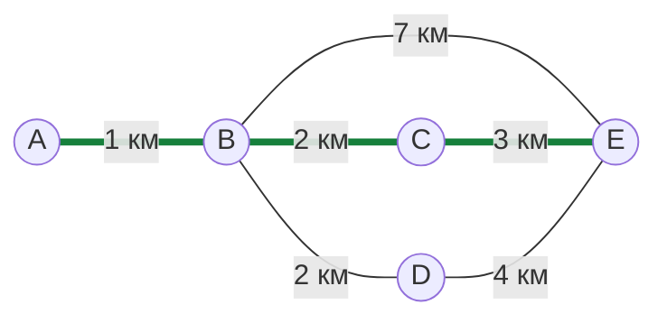
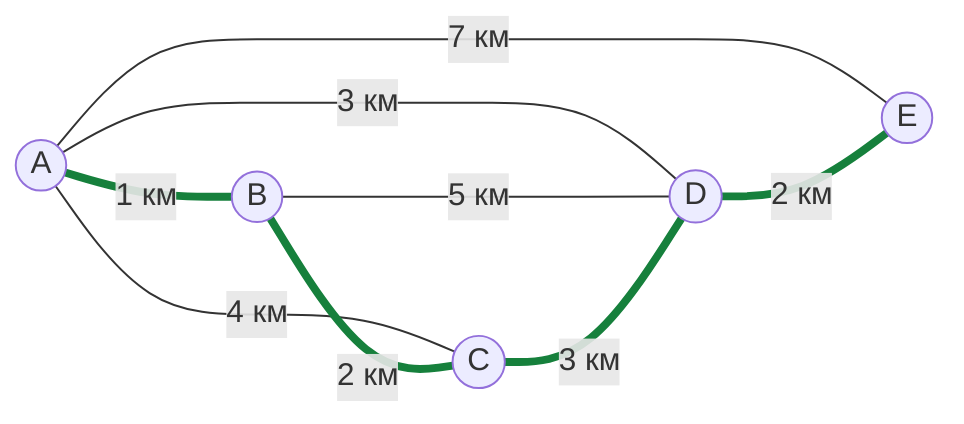

# Задание 4. Формальные модели и дороги

## Краткая теория

Таблица дорог описывает граф: строка и столбец — это пункты, число в ячейке — длина дороги, пустая ячейка — дороги нет. В обычной задаче о кратчайшем пути складывай длины только существующих дорог. Если схема и таблица сравниваются, проверяй, что каждой линии на схеме соответствует ненулевая ячейка и наоборот.

## Чтение таблицы и поиск кратчайшего пути

**Пример задания** ([№ 364](https://inf-oge.sdamgia.ru/problem?id=364))

Таблица показывает длины имеющихся дорог между шестью пунктами:

|   | A | B | C | D | E | F |
|---|---:|---:|---:|---:|---:|---:|
| A | — | 6 | 4 | 2 | 1 | — |
| B | 6 | — | 1 | — | — | — |
| C | 4 | 1 | — | 3 | — | 2 |
| D | 2 | — | 3 | — | 2 | — |
| E | 1 | — | — | 2 | — | 6 |
| F | — | — | 2 | — | 6 | — |

Найдите минимальную суммарную длину маршрута из A в F, пользуясь только дорогами из таблицы.

**Решение.** Сравним возможные короткие маршруты. По пути А—С—F длина равна `4 + 2 = 6`. Например, А—Е—F имеет длину `1 + 6 = 7`, А—D—C—F — `2 + 3 + 2 = 7`. Значит, кратчайший маршрут — А—С—F.

**Ответ: 6.** В опубликованном решении перечислены маршруты и подтверждено, что минимальная длина равна 6.

## Сопоставление таблицы и схемы

**Пример задания** ([№ 4908](https://inf-oge.sdamgia.ru/problem?id=4908))

Таблица стоимости перевозок описывает связи между станциями A, B, C, D и E. По ней требуется выбрать подходящую схему среди изображённых на странице вариантов 1–4.

|   | A | B | C | D | E |
|---|---:|---:|---:|---:|---:|
| A | — | 1 | 4 | — | 1 |
| B | 1 | — | — | 3 | — |
| C | 4 | — | — | — | 2 |
| D | — | 3 | — | — | — |
| E | 1 | — | 2 | — | — |

**Решение.** Сверяем уникальные признаки: из D выходит только одна дорога — в B; между A и E есть дорога длиной 1. Из предложенных схем этим условиям соответствует схема 2.

**Ответ: 2.**

---

## Пример из присланного списка: кратчайший путь между A и E

**Задача** ([РешуОГЭ, тип 4 № 3](https://inf-oge.sdamgia.ru/problem?id=3); источник на сайте — ГИА по информатике, 2013 год). По таблице определить длину кратчайшего пути из A в E, используя только существующие дороги.

|   | A | B | C | D | E |
|---|---:|---:|---:|---:|---:|
| A | — | 1 | — | — | — |
| B | 1 | — | 2 | 2 | 7 |
| C | — | 2 | — | — | 3 |
| D | — | 2 | — | — | 4 |
| E | — | 7 | 3 | 4 | — |

На схеме каждая линия — существующая дорога, число на ней — её длина. Зелёным выделен самый короткий маршрут.

Из A можно попасть только в B, поэтому сравниваем все продолжения от B до E:

| Маршрут | Подсчёт | Длина |
|---|---:|---:|
| **A—B—C—E** | `1 + 2 + 3` | **6 км** |
| A—B—D—E | `1 + 2 + 4` | 7 км |
| A—B—E | `1 + 7` | 8 км |

Кратчайший маршрут — A—B—C—E, длина — **6**. На странице задачи опубликовано то же решение. [Аналог № 63](https://inf-oge.sdamgia.ru/problem?id=63) имеет ответ 7; ещё один вариант — [№ 123](https://inf-oge.sdamgia.ru/problem?id=123), ответ 7.

## Свежий вариант с обязательным промежуточным пунктом

**Задача** ([РешуОГЭ, № 43351](https://inf-oge.sdamgia.ru/problem?id=43351), ОГЭ-2025, основная волна). Найти кратчайший путь из A в E через C; каждый пункт можно посетить только один раз.

|   | A | B | C | D | E |
|---|---:|---:|---:|---:|---:|
| A | — | 1 | 4 | 3 | 7 |
| B | 1 | — | 2 | 5 | — |
| C | 4 | 2 | — | 3 | — |
| D | 3 | 5 | 3 | — | 2 |
| E | 7 | — | — | 2 | — |

На графе выделен кратчайший маршрут, проходящий через обязательный пункт C.

Сравним допустимые маршруты, которые проходят через C и не повторяют пункты:

| Маршрут | Подсчёт | Длина |
|---|---:|---:|
| **A—B—C—D—E** | `1 + 2 + 3 + 2` | **8 км** |
| A—C—D—E | `4 + 3 + 2` | 9 км |
| A—C—B—D—E | `4 + 2 + 5 + 2` | 13 км |

Таблица допускает все три маршрута без повторного посещения пунктов. В опубликованном разборе приведены первые два; третий, более длинный маршрут не влияет на ответ. Кратчайший путь — A—B—C—D—E, ответ **8**. Этот пример удобно использовать, чтобы проверить, что программа учитывает обязательный пункт C, а не только начало и конец маршрута.

## Перебор маршрутов в TypeScript

Для небольших графов из задания ручной перебор можно перенести в программу. Подробные пояснения к структурам данных, проверкам и возврату после каждого маршрута находятся в комментариях самого TypeScript-файла.

- [Решение на TypeScript](Решение_кодом/Решение.ts)

