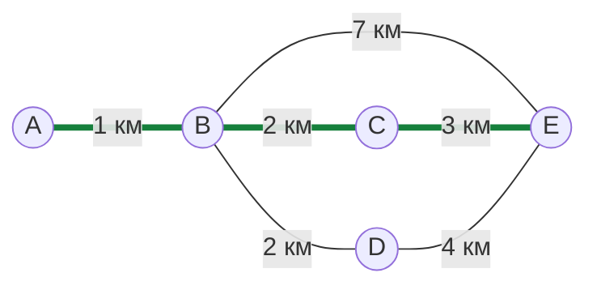
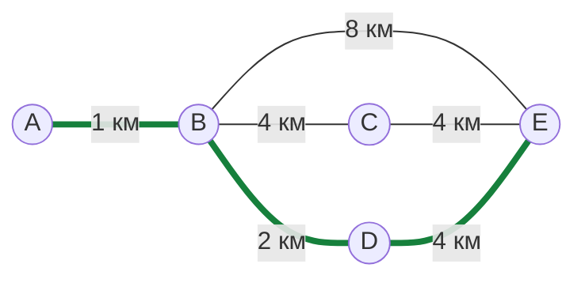
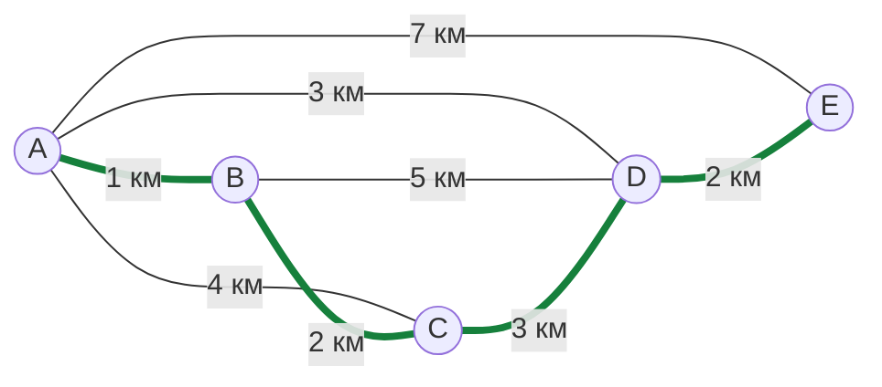

# Задание 4. Формальные модели и дороги

## Краткая теория

Таблица дорог описывает граф: строка и столбец — это пункты, число в ячейке — длина дороги, пустая ячейка — дороги нет. В обычной задаче о кратчайшем пути складывай длины только существующих дорог. Если схема и таблица сравниваются, проверяй, что каждой линии на схеме соответствует ненулевая ячейка и наоборот.

---

## Задача 3. Кратчайший путь между A и E

**Задача** ([РешуОГЭ, тип 4 № 3](https://inf-oge.sdamgia.ru/problem?id=3); источник на сайте — ГИА по информатике, 2013 год). По таблице определить длину кратчайшего пути из A в E, используя только существующие дороги.

|   | A | B | C | D | E |
|---|---:|---:|---:|---:|---:|
| A | — | 1 | — | — | — |
| B | 1 | — | 2 | 2 | 7 |
| C | — | 2 | — | — | 3 |
| D | — | 2 | — | — | 4 |
| E | — | 7 | 3 | 4 | — |

На схеме каждая линия — существующая дорога, число на ней — её длина. Зелёным выделен самый короткий маршрут.

Из A можно попасть только в B, поэтому сравниваем все продолжения от B до E:

| Маршрут | Подсчёт | Длина |
|---|---:|---:|
| **A—B—C—E** | `1 + 2 + 3` | **6 км** |
| A—B—D—E | `1 + 2 + 4` | 7 км |
| A—B—E | `1 + 7` | 8 км |

Кратчайший маршрут — A—B—C—E, длина — **6**. На странице задачи опубликовано то же решение.

## Задача 63. Кратчайший путь между A и E

**Условие** ([РешуОГЭ, тип 4 № 63](https://inf-oge.sdamgia.ru/problem?id=63), ГИА по информатике, 2013, основная волна). Между пунктами A, B, C, D и E построены дороги; в таблице указана их протяжённость в километрах. Найдите длину кратчайшего пути из A в E.

|   | A | B | C | D | E |
|---|---:|---:|---:|---:|---:|
| A | — | 1 | — | — | — |
| B | 1 | — | 4 | 2 | 8 |
| C | — | 4 | — | — | 4 |
| D | — | 2 | — | — | 4 |
| E | — | 8 | 4 | 4 | — |

Из A можно попасть только в B, поэтому сравним маршруты от B до E:

| Маршрут | Подсчёт | Длина |
|---|---:|---:|
| A—B—C—E | `1 + 4 + 4` | 9 км |
| A—B—E | `1 + 8` | 9 км |
| **A—B—D—E** | `1 + 2 + 4` | **7 км** |

Кратчайший маршрут — A—B—D—E, длина — **7 км**. Это совпадает с опубликованным решением.

## Свежий вариант с обязательным промежуточным пунктом

**Задача** ([РешуОГЭ, № 43351](https://inf-oge.sdamgia.ru/problem?id=43351), ОГЭ-2025, основная волна). Найти кратчайший путь из A в E через C; каждый пункт можно посетить только один раз.

|   | A | B | C | D | E |
|---|---:|---:|---:|---:|---:|
| A | — | 1 | 4 | 3 | 7 |
| B | 1 | — | 2 | 5 | — |
| C | 4 | 2 | — | 3 | — |
| D | 3 | 5 | 3 | — | 2 |
| E | 7 | — | — | 2 | — |

На графе выделен кратчайший маршрут, проходящий через обязательный пункт C.

Сравним допустимые маршруты, которые проходят через C и не повторяют пункты:

| Маршрут | Подсчёт | Длина |
|---|---:|---:|
| **A—B—C—D—E** | `1 + 2 + 3 + 2` | **8 км** |
| A—C—D—E | `4 + 3 + 2` | 9 км |
| A—C—B—D—E | `4 + 2 + 5 + 2` | 13 км |

Таблица допускает все три маршрута без повторного посещения пунктов. В опубликованном разборе приведены первые два; третий, более длинный маршрут не влияет на ответ. Кратчайший путь — A—B—C—D—E, ответ **8**. Этот пример удобно использовать, чтобы проверить, что программа учитывает обязательный пункт C, а не только начало и конец маршрута.

## Перебор маршрутов в TypeScript

Для небольших графов из задания ручной перебор можно перенести в программу. Подробные пояснения к структурам данных, проверкам и возврату после каждого маршрута находятся в комментариях самого TypeScript-файла.

- [Решение на TypeScript](Решение_кодом/Решение.ts)

### Анимация обхода в глубину

Пошаговый разбор маршрутов для графов Problem 3, Problem 63 и Problem 43351 вынесен в отдельную интерактивную страницу:
[Открыть анимацию обхода графов](Решение_кодом/Обход_графов.html).

