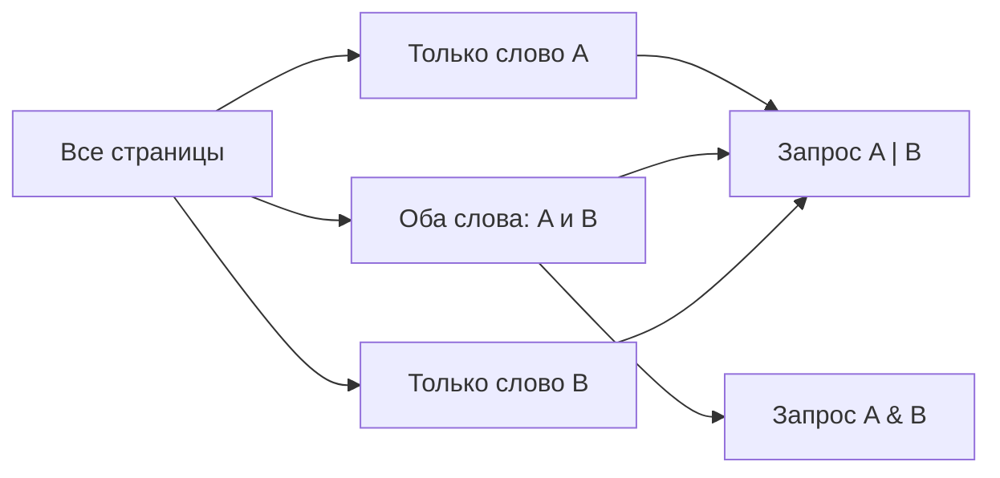

# Задание 8. Запросы и логика множеств

## Краткая теория

`&` означает «И»: подходят страницы, где есть оба слова. `|` означает «ИЛИ»: подходят страницы хотя бы с одним из слов. Пересечение учитывается в каждом запросе, куда оно входит. Удобно нарисовать круги Эйлера и обозначить области.

## Запрос из двух слов

**Пример задания № 10477.** Для запросов «Угол | Прямая», «Угол» и «Прямая» получено соответственно 180, 60 и 140 тысяч страниц. Сколько страниц найдётся по запросу «Угол & Прямая»?

> «Какое количество страниц (в тысячах) будет найдено по запросу Угол & Прямая?»

**Решение.** Объединение двух множеств — 180. Если сложить размеры множеств слов «Угол» и «Прямая», общая часть посчитается дважды. Поэтому пересечение: `60 + 140 − 180 = 20` тысяч.

**Ответ: 20 тысяч страниц.** [Задание и разбор](https://inf-oge.sdamgia.ru/problem?id=10477) · [Подраздел каталога](https://inf-oge.sdamgia.ru/test?category_id=43&filter=all)

## Запрос из одного слова

**Пример задания № 10473.** Найдено: по запросу «Рыбак | Рыбка» — 780 тысяч страниц; по «Рыбак» — 260 тысяч; по «Рыбак & Рыбка» — 50 тысяч. Сколько страниц найдётся по запросу «Рыбка»?

> «Какое количество страниц (в тысячах) будет найдено по запросу Рыбка?»

**Решение.** Из объединения вычтем все страницы со словом «Рыбак»: останутся только страницы со словом «Рыбка», но без «Рыбак»: `780 − 260 = 520`. Добавим пересечение, где встречаются оба слова: `520 + 50 = 570` тысяч.

**Ответ: 570 тысяч страниц.** [Задание и разбор](https://inf-oge.sdamgia.ru/problem?id=10473) · [Подраздел каталога](https://inf-oge.sdamgia.ru/test?category_id=26&filter=all)

## Запрос из трёх слов

**Пример задания № 36879.** Запрос «Математика & Информатика» находит 330 тыс. страниц, «Математика & Физика» — 270 тыс., а «Математика & (Информатика | Физика)» — 520 тыс. Найдите число страниц по запросу «Математика & Информатика & Физика».

> «Какое количество страниц (в тысячах) будет найдено по запросу Математика & Информатика & Физика?»

**Решение.** Обозначим пересечение всех трёх слов через `x`. Тогда только пересечение математики с информатикой без физики — `330 − x`; с физикой без информатики — `270 − x`. Их объединение вместе с общим пересечением равно 520:

`(330 − x) + x + (270 − x) = 520`, откуда `x = 80`.

**Ответ: 80 тысяч страниц.** [Задание и разбор](https://inf-oge.sdamgia.ru/problem?id=36879) · [Подраздел каталога](https://inf-oge.sdamgia.ru/test?category_id=77&filter=all)

## Решения с помощью кода

- [Пересечение двух запросов — Python](Решение_кодом/Пересечение_двух_запросов/Решение.py) · [TypeScript](Решение_кодом/Пересечение_двух_запросов/Решение.ts)
- [Восстановление количества для одного слова — Python](Решение_кодом/Количество_одного_слова/Решение.py) · [TypeScript](Решение_кодом/Количество_одного_слова/Решение.ts)
- [Пересечение трёх запросов — Python](Решение_кодом/Пересечение_трёх_запросов/Решение.py) · [TypeScript](Решение_кодом/Пересечение_трёх_запросов/Решение.ts)
