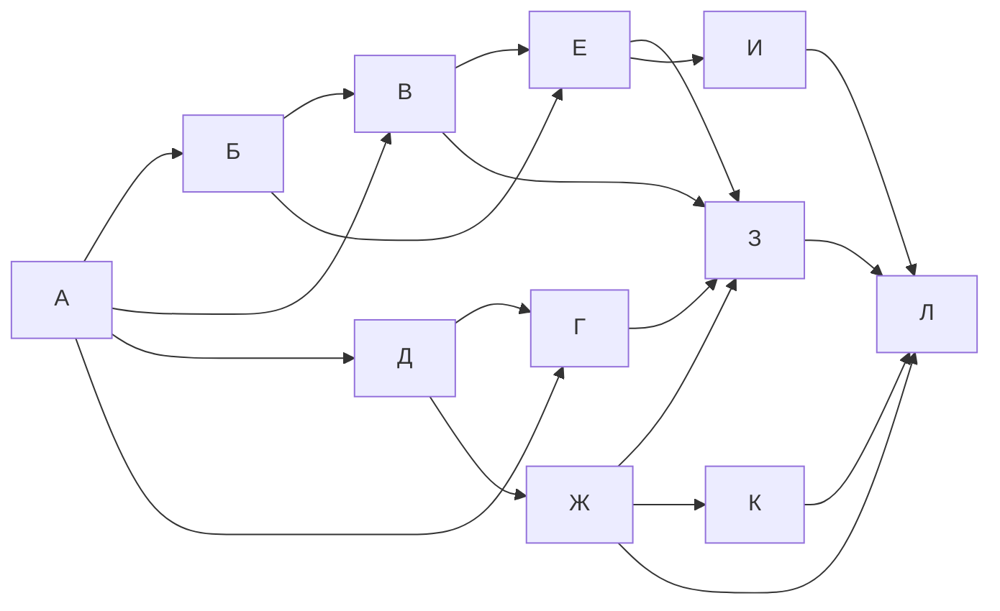

# Задание 9. Пути по схеме дорог

## Краткая теория

Считай число путей от начала схемы к каждому городу. В начальном городе — 1. Для следующего города сложи числа путей во все города, из которых в него ведут стрелки. Если путь обязан проходить через определённый город, исключи варианты, которые обходят его; можно отдельно перемножить число путей до обязательного города и после него.

## Все пути

**Пример задания № 16017.** На схеме показаны односторонние дороги между городами А, Б, В, Г, Д, Е, Ж, З, И, К и Л. Сколько различных путей ведёт из А в Л?

> «На рисунке — схема дорог, связывающих города А, Б, В, Г, Д, Е, Ж, З, И, К и Л. По каждой дороге можно двигаться только в одном направлении».

В исходном условии схема дана картинкой. Её содержимое не удалось отдельно загрузить; ниже приведена схема переходов, восстановленная по суммам предшественников в официальном решении.

Схему можно представить переходами, указанными в официальном разборе:

**Решение.** Считаем по стрелкам: А=1; Б=1; В=А+Б=2; Д=1; Г=А+Д=2; Е=Б+В=3; Ж=Д+Г=3; З=В+Г+Е+Ж=10; И=Е=3; К=Ж=3; Л=Е+Ж+З+И+К=22.

**Ответ: 22 пути.** [Задание и разбор](https://inf-oge.sdamgia.ru/problem?id=16017) · [Подраздел каталога](https://inf-oge.sdamgia.ru/test?category_id=44&filter=all)

## Путь через заданный город

**Пример задания № 10245.** На схеме показаны односторонние дороги между городами А, Б, В, Г, Д, Е, Ж, З и И. Сколько различных путей из А в И проходят через В?

> «Сколько существует различных путей из города А в город И, проходящих через город В?»

В условии есть отдельная схема-картинка; её изображение недоступно. Условие и ответ можно проверить по ссылке на задание. Для объяснения ниже используется числовой разбор сайта.

**Решение.** По официальному разбору число путей до В равно 4. После В к И можно добраться тремя способами. Каждый полный маршрут через В складывается из участка А→В и участка В→И, поэтому `4 × 3 = 12`.

**Ответ: 12 путей.** [Задание и разбор](https://inf-oge.sdamgia.ru/problem?id=10245) · [Подраздел каталога](https://inf-oge.sdamgia.ru/test?category_id=22&filter=all)
