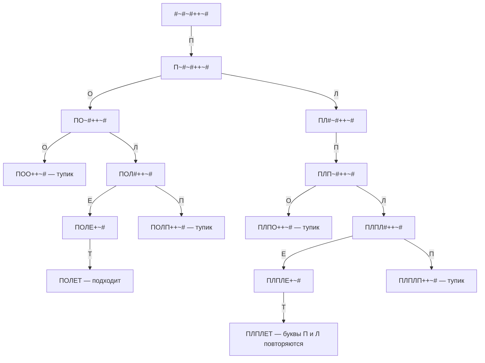
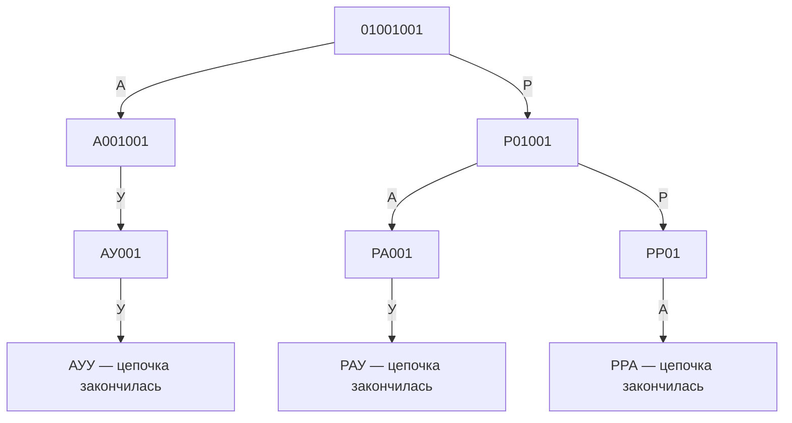
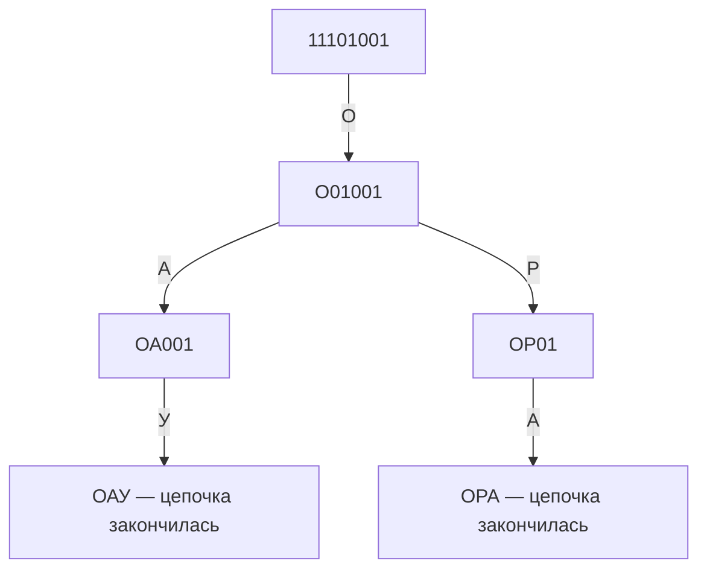
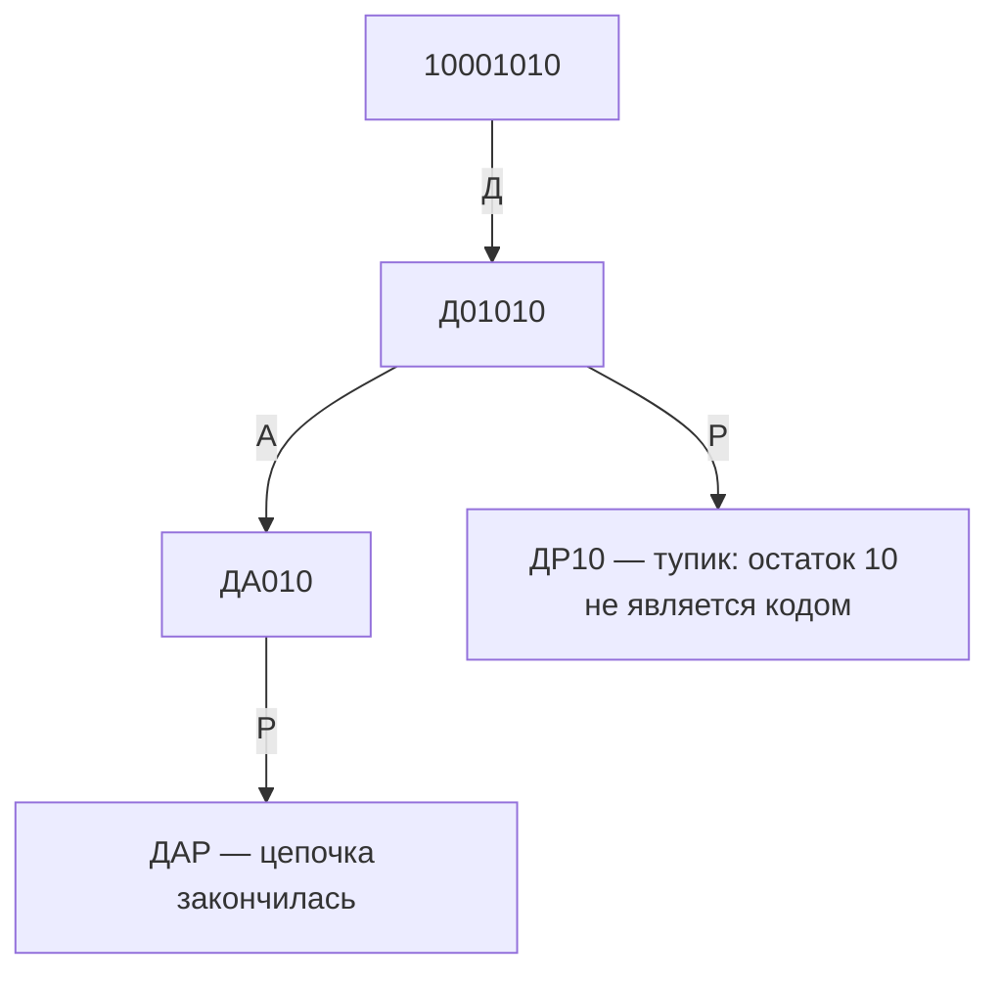

# ПЛАН ТРЕТЬЕГО ЗАНЯТИЯ ПО ИНФОРМАТИКЕ
**Подготовка к ОГЭ, 9 класс**

**Ученик:** Дарий (индивидуальное занятие)  
**Продолжительность:** 60 минут  
**Тема:** Проверка домашнего задания; кодирование и декодирование информации; задание 2 ОГЭ

**Связанные материалы:**
- Предыдущий урок: [план второго занятия](../2%20урок%20(задание%202%20и%20код)/plan_vtorogo_zanyatiya_oge.md)
- Код для разбора домашнего задания: [Решение_итоговое.ts](../../../../База_знаний/02_Кодирование_и_декодирование_информации/Решение_кодом/Шифр_из_символов/Решение_итоговое.ts)
- База знаний ОГЭ, задание 2: [Задание_02.md](../../../../База_знаний/02_Кодирование_и_декодирование_информации/Задание_02.md)
- [Навигатор подготовки ФИПИ к ОГЭ по информатике, 2026](https://doc.fipi.ru/navigator-podgotovki/navigator-oge/MR_informatika_oge_2026.pdf)

---

## Цели занятия

1. Проверить домашнее задание: разбор фрагмента итогового кода декодера.
2. Научить декодировать строку по таблице соответствия «символ — код».
3. Показать, как перебирать все варианты разбиения, если коды имеют разную длину и строка записана без разделителей.
4. Научить проверять, что цепочка разобрана до конца, и отличать единственное декодирование от неоднозначного.

**Ожидаемый результат:** Дарий может объяснить ход декодирования, показать границы кодов и обосновать, почему найден один или несколько вариантов.

## Методические акценты

- Короткое объяснение — сразу практика; не говорить теорию дольше 5–7 минут подряд.
- При неоднозначном разборе не угадывать «подходящий» код: отмечать каждую ветку и отбрасывать её только тогда, когда остаток строки невозможно разбить.
- Записывать ответ вместе с разделением исходной цепочки на коды, например: `100 | 01 | 010 → ДАР`.
- При индивидуальной работе чередовать роли решающего и проверяющего: Дарий объясняет ход решения, затем сам проверяет полноту перебора.

## Генеральный план занятия

| Время | Блок | Содержание |
|---|---|---|
| 0–3 | Вход и настрой | Цель урока, короткое повторение: что такое код и декодирование |
| 3–12 | Проверка домашней работы | Разбор фрагмента итогового кода: Дарий объясняет перебор вариантов и добавление состояний в стек |
| 12–16 | Введение в задание 2 | Таблица кодов, границы кодов, отличие кодирования от декодирования |
| 16–28 | Разбор символьного шифра | Совместное декодирование строки `#~#~#++~#` |
| 28–31 | Смена деятельности | Мини-разминка «код или сообщение?» |
| 31–43 | Неоднозначные двоичные коды | Демонстрация перебора вариантов на двоичной цепочке |
| 43–53 | Самостоятельная практика | Дарий решает две цепочки по очереди и сверяет ход рассуждений с преподавателем |
| 53–57 | Выходная проверка | Короткое задание и вопросы на объяснение алгоритма |
| 57–60 | Итоги и домашнее задание | Рефлексия, выдача двух коротких задач |

---

## Этап 1. Вход и настрой (0–3 минуты)

Коротко напомнить: сегодня не переводим числа из одной системы счисления в другую — расшифровываем строку по таблице кодов. Попросить Дария своими словами объяснить разницу:

- **кодирование** — заменить символы кодами;
- **декодирование** — восстановить символы по кодовой строке и таблице.

Попросить Дария объяснять свои решения вслух и проверять, что использована вся цепочка.

## Этап 2. Проверка домашней работы (3–12 минут)

### 2.1. Разбор домашнего кода (5 минут)

Попросить Дария открыть [Решение_итоговое.ts](../../../../База_знаний/02_Кодирование_и_декодирование_информации/Решение_кодом/Шифр_из_символов/Решение_итоговое.ts) и объяснить строки 33–44: как перебираются коды, проверяется их совпадение с текущей позиции, создаётся новое состояние и добавляется в стек.

### 2.2. Вопросы для проверки понимания

1. Что перебирает цикл `for...of` по `Object.entries(codeToLetter)`?
2. Зачем одновременно проверяются `!usedLetters.has(letter)` и `encodedMessage.startsWith(code, pointer)`?
3. Почему для каждой подходящей буквы создаётся копия множества `usedLetters`?
4. Какие данные сохраняются в состоянии, которое добавляется в `stack`?

Ожидаемый разбор: программа рассматривает каждую пару «код — буква»; продолжает только если буква ещё не использовалась и строка начинается с этого кода в позиции `pointer`; копирует множество, добавляет новую букву, сдвигает указатель на длину кода и сохраняет новое состояние в стеке. Если Дарий затрудняется, проследить вместе один подходящий код на текущей позиции.

## Этап 3. Введение в задание 2 (12–16 минут)

Показать небольшую таблицу кодов и строку, составленную из этих кодов. Обсудить три вопроса:

1. Какой фрагмент строки может быть кодом первого символа?
2. Где заканчивается этот код и что остаётся расшифровать?
3. Как проверить, что вся строка использована и ни один знак не потерян?

Подвести к алгоритму: сравниваем начало остатка строки со всеми кодами, выбираем подходящие варианты, продолжаем разбор для каждого; незавершённые варианты отбрасываем. При кодах одинаковой длины разбиение обычно проще, а при кодах разной длины может быть неоднозначность.

## Этап 4. Совместный разбор символьного шифра (16–28 минут)

### Условие задания

> В таблице ниже каждой букве соответствует цепочка знаков. Получена строка `#~#~#++~#`. В ней закодированы неповторяющиеся буквы. Определите исходное сообщение.

| Буква | А | Е | Л | П | Т | О |
|---|---|---|---|---|---|---|
| Код | `+#` | `#+` | `~` | `#` | `+~#` | `~#` |

**Полная строка для декодирования:** `#~#~#++~#`

**Задание на РешуОГЭ:** [№ 37187](https://inf-oge.sdamgia.ru/problem?id=37187)

Сначала попросить Дария предложить, какие коды подходят к началу строки. В каждом узле дерева записывать уже восстановленные буквы и остаток строки; на стрелке указывать букву, код которой выбран. Например, после выбора `# → П` состояние меняется с `#~#~#++~#` на `П~#~#++~#`. Если остаток нельзя продолжить, ветка заканчивается тупиком. Полностью разобранные варианты с повторяющимися буквами не подходят условию.

### Дерево вариантов



Код `#+ → Е` не подходит в самом начале: первые два знака исходной строки — `#~`. В конце принять только полное декодирование без повторяющихся букв.

Искомое разбиение:

```text
# | ~# | ~ | #+ | +~#
П    О    Л    Е     Т
```

**Ответ: ПОЛЕТ.** Проверить, что использованы все знаки исходной строки, каждый код соответствует таблице, а буквы не повторяются. Обратить внимание: одиночный `#` — код П, но `#+` — код Е; какой из них можно взять, зависит от следующего знака и от того, удастся ли разобрать остаток.

## Этап 5. Смена деятельности (28–31 минута)

Короткий устный блиц без записи:

- «Кодовая таблица дана — что мы делаем: кодируем или декодируем?»
- «Если код не подходит к началу строки, что делаем с этой веткой?»
- «Можно ли считать разбор завершённым, если часть строки осталась?»

Ответы: декодируем; отбрасываем эту ветку; нет, должна быть использована вся цепочка.

## Этап 6. Неоднозначные двоичные коды (31–43 минуты)

### Полное условие задания

> Для записи слова каждому символу присваивается двоичный код:

| Буква | А | В | Д | О | Р | У |
|---|---:|---:|---:|---:|---:|---:|
| Код | `01` | `011` | `100` | `111` | `010` | `001` |

> Поскольку коды имеют разную длину, одна строка иногда допускает несколько разбиений. Проверьте три сообщения — `01001001`, `11101001`, `10001010` — и найдите то, которое раскладывается на буквы единственным способом. Запишите полученное слово.

**Задание на РешуОГЭ:** [№ 4717](https://inf-oge.sdamgia.ru/problem?id=4717)

Объяснить, что здесь коды имеют разную длину и некоторые начинаются одинаково. Поэтому после короткого совпадения не нужно сразу фиксировать ответ: надо сохранить альтернативу и проверить каждую ветку до конца.

### Совместный разбор цепочки `01001001`

Предложить Дарию не угадывать слово, а пройти по всем подходящим кодам. В узлах дерева записывать восстановленные буквы и остаток цепочки, на стрелках — выбранную букву:



В начале подходят коды `01` (А) и `010` (Р). Все ветки приводят к полному декодированию, поэтому у цепочки три варианта: **АУУ**, **РАУ** и **РРА**. Подчеркнуть, что для вывода о неоднозначности нужно довести до конца каждую ветку.

### Примечание преподавателю

В текущем файле базы знаний для цепочки `01001001` перечислены только два варианта, но есть и третий: `010 | 01 | 001` → **РАУ**. Предложить Дарию проверить все ветки и зафиксировать все три разбиения. Это поможет подчеркнуть требование полного перебора.

## Этап 7. Самостоятельная практика (43–53 минуты)

Дарий по очереди решает две цепочки и записывает шаги расшифровки в формате «восстановленные буквы + остаток цепочки». После каждого решения вместе проверить, все ли варианты перебраны.

1. **Задание 1 — `11101001`.** Найти все варианты расшифровки.
2. **Задание 2 — `10001010`.** Найти расшифровку и доказать, что она единственная.

### Схемы расшифровки для преподавателя

#### Задание пары 1: `11101001`



**Ответ:** два варианта — **ОАУ** (`111 | 01 | 001`) и **ОРА** (`111 | 010 | 01`).

#### Задание пары 2: `10001010`



**Ответ:** **ДАР** (`100 | 01 | 010`). Это единственный полный вариант: ветка `ДР` не подходит, потому что остаток `10` нельзя разбить на коды из таблицы.

**Вопросы-подсказки, если возникли затруднения:**
- «Какие коды подходят к первым знакам?»
- «Что остаётся после того, как записали этот код?»
- «Можно ли полностью разбить оставшуюся часть?»
- «Проверили ли вы все подходящие варианты первого кода?»

## Этап 8. Выходная проверка и рефлексия (53–57 минут)

Попросить Дария завершить фразы:

- «Если коды разной длины, я сначала…»
- «Я понимаю, что разбор закончился, когда…»
- «Чтобы доказать, что вариант единственный, нужно…»

Критерий усвоения: ученик не угадывает слово, а записывает деление строки на коды и проверяет все подходящие ветки.

## Этап 9. Домашнее задание (57–60 минут)

Вместо упражнений из этого плана задать две задачи с РешуОГЭ. Попросить записать ход расшифровки и показать, почему других вариантов нет, если задача требует единственного ответа.

1. [РешуОГЭ, задание № 187 — шифр из символов](https://inf-oge.sdamgia.ru/problem?id=187). Расшифровать сообщение `#++^##^#^` по таблице на странице; буквы в сообщении не повторяются.
2. [РешуОГЭ, задание № 348 — шифр из цифр](https://inf-oge.sdamgia.ru/problem?id=348). Проверить четыре цифровые цепочки из задания и найти ту, у которой только один вариант расшифровки.

### Ответы для преподавателя

1. № 187: **ЛЕСКА**.
2. № 348: единственная цепочка — `51201`; ответ — **ДАТА**.

---

## Подготовка к занятию

- [ ] Выписать или вывести таблицы кодов из этапов 4 и 6.
- [ ] Подготовить двоичные цепочки из базы знаний и карточки для самостоятельной практики.
- [ ] Заранее выделить на доске место для дерева вариантов: каждая ветка должна завершиться полным разбиением или быть явно отброшена.
