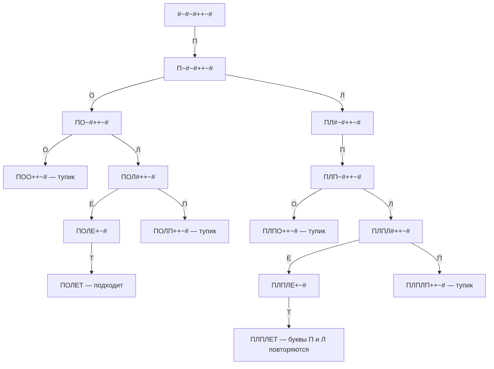
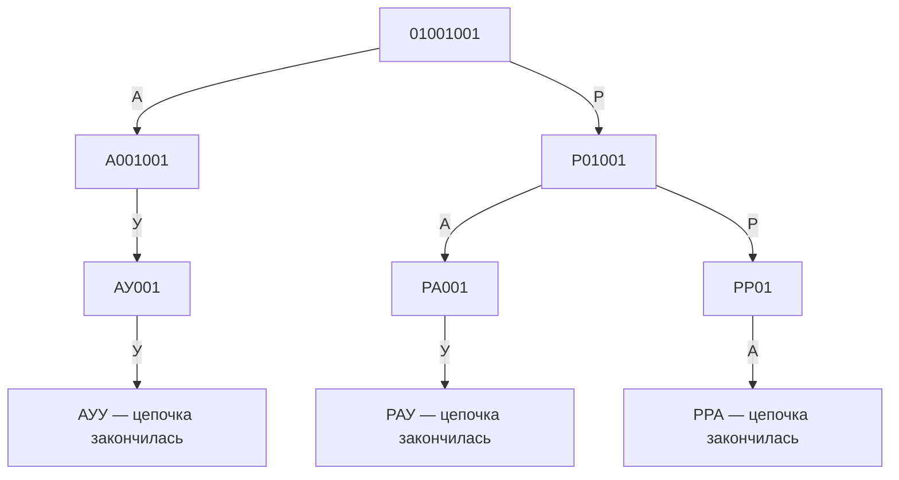
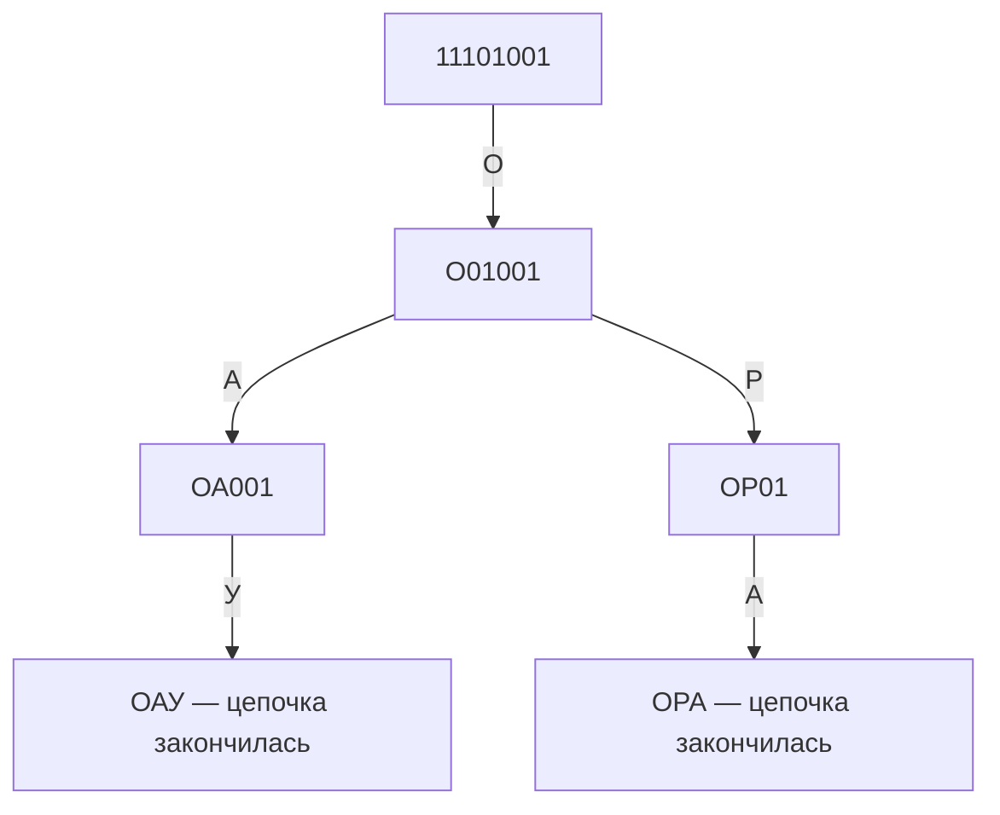
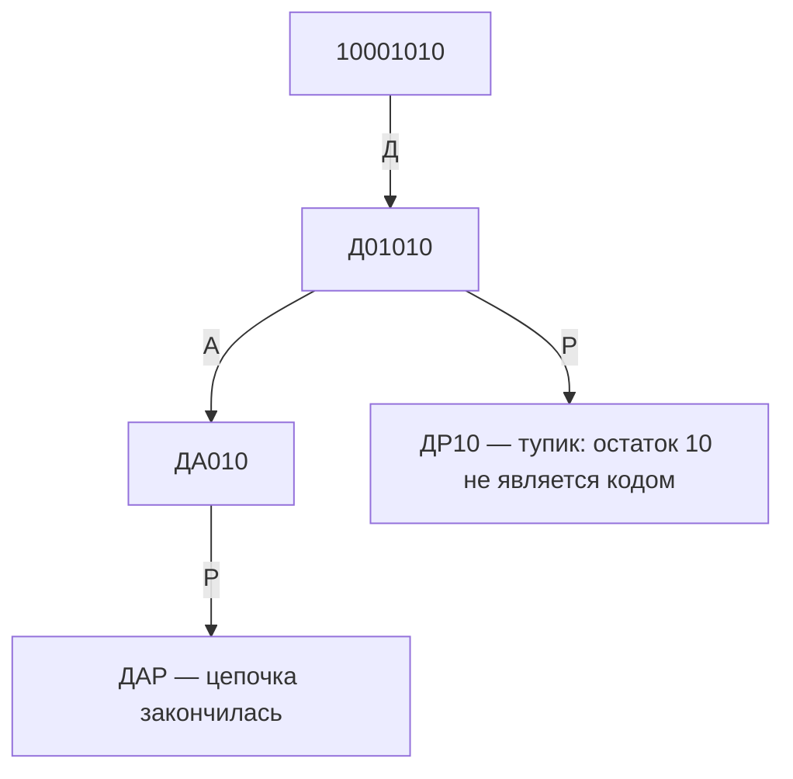

# ПЛАН ТРЕТЬЕГО ЗАНЯТИЯ ПО ИНФОРМАТИКЕ
**Подготовка к ОГЭ, 9 класс**

**Группа:** «казаки», 4 ученика  
**Продолжительность:** 60–90 минут (основной тайминг — 80 минут + 10 минут резерв)  
**Тема:** Проверка домашнего задания; кодирование и декодирование информации; задание 2 ОГЭ

**Связанные материалы:**
- Итоги предыдущего занятия: [Итоги_урока_2.md](../2%20урок%20(сложение%20битов%20и%20задание%201)/Итоги_урока_2.md)
- Домашнее задание: [план второго занятия](../2%20урок%20(сложение%20битов%20и%20задание%201)/plan_vtorogo_zanyatiya_oge.md)
- База знаний ОГЭ, задание 2: [Задание_02.md](../../../../База_знаний/02_Кодирование_и_декодирование_информации/Задание_02.md)
- [Навигатор подготовки ФИПИ к ОГЭ по информатике, 2026](https://doc.fipi.ru/navigator-podgotovki/navigator-oge/MR_informatika_oge_2026.pdf)

---

## Цели занятия

1. Проверить домашнюю работу по сложению двоичных чисел и заданию 1 ОГЭ.
2. Научить декодировать строку по таблице соответствия «символ — код».
3. Показать, как перебирать все варианты разбиения, если коды имеют разную длину и строка записана без разделителей.
4. Научить проверять, что цепочка разобрана до конца, и отличать единственное декодирование от неоднозначного.

**Ожидаемый результат:** каждый ученик может объяснить ход декодирования, показать границы кодов и обосновать, почему найден один или несколько вариантов.

## Методические акценты

- Короткое объяснение — сразу практика; не говорить теорию дольше 5–7 минут подряд.
- При неоднозначном разборе не угадывать «подходящий» код: отмечать каждую ветку и отбрасывать её только тогда, когда остаток строки невозможно разбить.
- Записывать ответ вместе с разделением исходной цепочки на коды, например: `100 | 01 | 010 → ДАР`.
- Роли в группе менять по кругу: решающий, проверяющий, оппонент, таймкипер.

## Генеральный план занятия

| Время | Блок | Содержание |
|---|---|---|
| 0–5 | Вход и настрой | Цель урока, роли, короткое повторение: что такое код и декодирование |
| 5–17 | Проверка домашней работы | Три примера на сложение битов и задача 1 ОГЭ; ученики объясняют решения |
| 17–22 | Введение в задание 2 | Таблица кодов, границы кодов, отличие кодирования от декодирования |
| 22–37 | Разбор символьного шифра | Совместное декодирование строки `#~#~#++~#` |
| 37–42 | Смена деятельности | Мини-разминка «код или сообщение?» и смена ролей |
| 42–57 | Неоднозначные двоичные коды | Демонстрация перебора вариантов на двоичной цепочке |
| 57–70 | Работа в парах | Каждая пара решает одну цепочку; затем пары проверяют решения друг друга |
| 70–75 | Выходная проверка | Короткое задание и вопросы на объяснение алгоритма |
| 75–80 | Итоги и домашнее задание | Рефлексия, выдача двух коротких задач |

---

## Этап 1. Вход и настрой (0–5 минут)

Коротко напомнить: сегодня не переводим числа из одной системы счисления в другую — расшифровываем строку по таблице кодов. Попросить учеников своими словами объяснить разницу:

- **кодирование** — заменить символы кодами;
- **декодирование** — восстановить символы по кодовой строке и таблице.

Распределить роли на первый пример; при переходе к работе в парах предложить ученикам поменяться ролями.

## Этап 2. Проверка домашней работы (5–17 минут)

### 2.1. Самостоятельная сверка (5 минут)

Попросить учеников показать вычисления, а не только назвать ответы. Проверяющий следит за переносами, оппонент делает проверку в десятичной системе.

### 2.2. Ответы для преподавателя

1. `1010₂ + 1₂ = 1011₂`. Проверка: `10 + 1 = 11`.
2. `110₂ + 10₂ = 1000₂`. Проверка: `6 + 2 = 8`.
3. `1111₂ + 1₂ = 10000₂`. Проверка: `15 + 1 = 16`.
4. В задаче про животных ответ — **попугай**: в КОИ-8 один символ занимает 1 байт; исчезло 9 символов, из них 2 — запятая и пробел. На слово приходится `9 − 2 = 7` букв.

Если в ответе есть ошибка, предложить ученику найти первый неверный разряд или неверно учтённый символ; затем дать группе короткую повторную попытку.

## Этап 3. Введение в задание 2 (17–22 минуты)

Показать небольшую таблицу кодов и строку, составленную из этих кодов. Обсудить три вопроса:

1. Какой фрагмент строки может быть кодом первого символа?
2. Где заканчивается этот код и что остаётся расшифровать?
3. Как проверить, что вся строка использована и ни один знак не потерян?

Подвести к алгоритму: сравниваем начало остатка строки со всеми кодами, выбираем подходящие варианты, продолжаем разбор для каждого; незавершённые варианты отбрасываем. При кодах одинаковой длины разбиение обычно проще, а при кодах разной длины может быть неоднозначность.

## Этап 4. Совместный разбор символьного шифра (22–37 минут)

### Условие задания

> В таблице ниже каждой букве соответствует цепочка знаков. Получена строка `#~#~#++~#`. В ней закодированы неповторяющиеся буквы. Определите исходное сообщение.

| Буква | А | Е | Л | П | Т | О |
|---|---|---|---|---|---|---|
| Код | `+#` | `#+` | `~` | `#` | `+~#` | `~#` |

**Полная строка для декодирования:** `#~#~#++~#`

**Задание на РешуОГЭ:** [№ 37187](https://inf-oge.sdamgia.ru/problem?id=37187)

Сначала попросить учеников самим предложить, какие коды подходят к началу строки. В каждом узле дерева записывать уже восстановленные буквы и остаток строки; на стрелке указывать букву, код которой выбран. Например, после выбора `# → П` состояние меняется с `#~#~#++~#` на `П~#~#++~#`. Если остаток нельзя продолжить, ветка заканчивается тупиком. Полностью разобранные варианты с повторяющимися буквами не подходят условию.

### Дерево вариантов



Код `#+ → Е` не подходит в самом начале: первые два знака исходной строки — `#~`. В конце принять только полное декодирование без повторяющихся букв.

Искомое разбиение:

```text
# | ~# | ~ | #+ | +~#
П    О    Л    Е     Т
```

**Ответ: ПОЛЕТ.** Проверить, что использованы все знаки исходной строки, каждый код соответствует таблице, а буквы не повторяются. Обратить внимание: одиночный `#` — код П, но `#+` — код Е; какой из них можно взять, зависит от следующего знака и от того, удастся ли разобрать остаток.

## Этап 5. Смена деятельности (37–42 минуты)

Короткий устный блиц без записи:

- «Кодовая таблица дана — что мы делаем: кодируем или декодируем?»
- «Если код не подходит к началу строки, что делаем с этой веткой?»
- «Можно ли считать разбор завершённым, если часть строки осталась?»

Ответы: декодируем; отбрасываем эту ветку; нет, должна быть использована вся цепочка. Сменить роли.

## Этап 6. Неоднозначные двоичные коды (42–57 минут)

### Полное условие задания

> Для записи слова каждому символу присваивается двоичный код:

| Буква | А | В | Д | О | Р | У |
|---|---:|---:|---:|---:|---:|---:|
| Код | `01` | `011` | `100` | `111` | `010` | `001` |

> Поскольку коды имеют разную длину, одна строка иногда допускает несколько разбиений. Проверьте три сообщения — `01001001`, `11101001`, `10001010` — и найдите то, которое раскладывается на буквы единственным способом. Запишите полученное слово.

**Задание на РешуОГЭ:** [№ 4717](https://inf-oge.sdamgia.ru/problem?id=4717)

Объяснить, что здесь коды имеют разную длину и некоторые начинаются одинаково. Поэтому после короткого совпадения не нужно сразу фиксировать ответ: надо сохранить альтернативу и проверить каждую ветку до конца.

### Совместный разбор цепочки `01001001`

Попросить группу не угадывать слово, а пройти по всем подходящим кодам. В узлах дерева записывать восстановленные буквы и остаток цепочки, на стрелках — выбранную букву:



В начале подходят коды `01` (А) и `010` (Р). Все ветки приводят к полному декодированию, поэтому у цепочки три варианта: **АУУ**, **РАУ** и **РРА**. Подчеркнуть, что для вывода о неоднозначности нужно довести до конца каждую ветку.

### Примечание преподавателю

В текущем файле базы знаний для цепочки `01001001` перечислены только два варианта, но есть и третий: `010 | 01 | 001` → **РАУ**. На уроке предложить ученикам самим проверить все ветки и зафиксировать все три разбиения. Это поможет подчеркнуть требование полного перебора.

## Этап 7. Работа в парах (57–70 минут)

Разделить группу на две пары. Каждая пара получает одно задание и записывает все шаги расшифровки в формате «восстановленные буквы + остаток цепочки». Затем пары обмениваются решениями и проверяют, все ли варианты перебраны.

1. **Пара 1 — `11101001`.** Найти все варианты расшифровки.
2. **Пара 2 — `10001010`.** Найти расшифровку и доказать, что она единственная.

### Схемы расшифровки для преподавателя

#### Задание пары 1: `11101001`



**Ответ:** два варианта — **ОАУ** (`111 | 01 | 001`) и **ОРА** (`111 | 010 | 01`).

#### Задание пары 2: `10001010`



**Ответ:** **ДАР** (`100 | 01 | 010`). Это единственный полный вариант: ветка `ДР` не подходит, потому что остаток `10` нельзя разбить на коды из таблицы.

**Вопросы-подсказки, если возникли затруднения:**
- «Какие коды подходят к первым знакам?»
- «Что остаётся после того, как записали этот код?»
- «Можно ли полностью разбить оставшуюся часть?»
- «Проверили ли вы все подходящие варианты первого кода?»

## Этап 8. Выходная проверка и рефлексия (70–75 минут)

Попросить каждого завершить фразы:

- «Если коды разной длины, я сначала…»
- «Я понимаю, что разбор закончился, когда…»
- «Чтобы доказать, что вариант единственный, нужно…»

Критерий усвоения: ученик не угадывает слово, а записывает деление строки на коды и проверяет все подходящие ветки.

## Этап 9. Домашнее задание (75–80 минут)

Вместо упражнений из этого плана задать две задачи с РешуОГЭ. Попросить записать ход расшифровки и показать, почему других вариантов нет, если задача требует единственного ответа.

1. [РешуОГЭ, задание № 187 — шифр из символов](https://inf-oge.sdamgia.ru/problem?id=187). Расшифровать сообщение `#++^##^#^` по таблице на странице; буквы в сообщении не повторяются.
2. [РешуОГЭ, задание № 348 — шифр из цифр](https://inf-oge.sdamgia.ru/problem?id=348). Проверить четыре цифровые цепочки из задания и найти ту, у которой только один вариант расшифровки.

### Ответы для преподавателя

1. № 187: **ЛЕСКА**.
2. № 348: единственная цепочка — `51201`; ответ — **ДАТА**.

---

## Подготовка к занятию

- [ ] Выписать или вывести таблицы кодов из этапов 4 и 6.
- [ ] Подготовить двоичные цепочки из базы знаний и карточки для самостоятельной практики.
- [ ] Заранее выделить на доске место для дерева вариантов: каждая ветка должна завершиться полным разбиением или быть явно отброшена.
