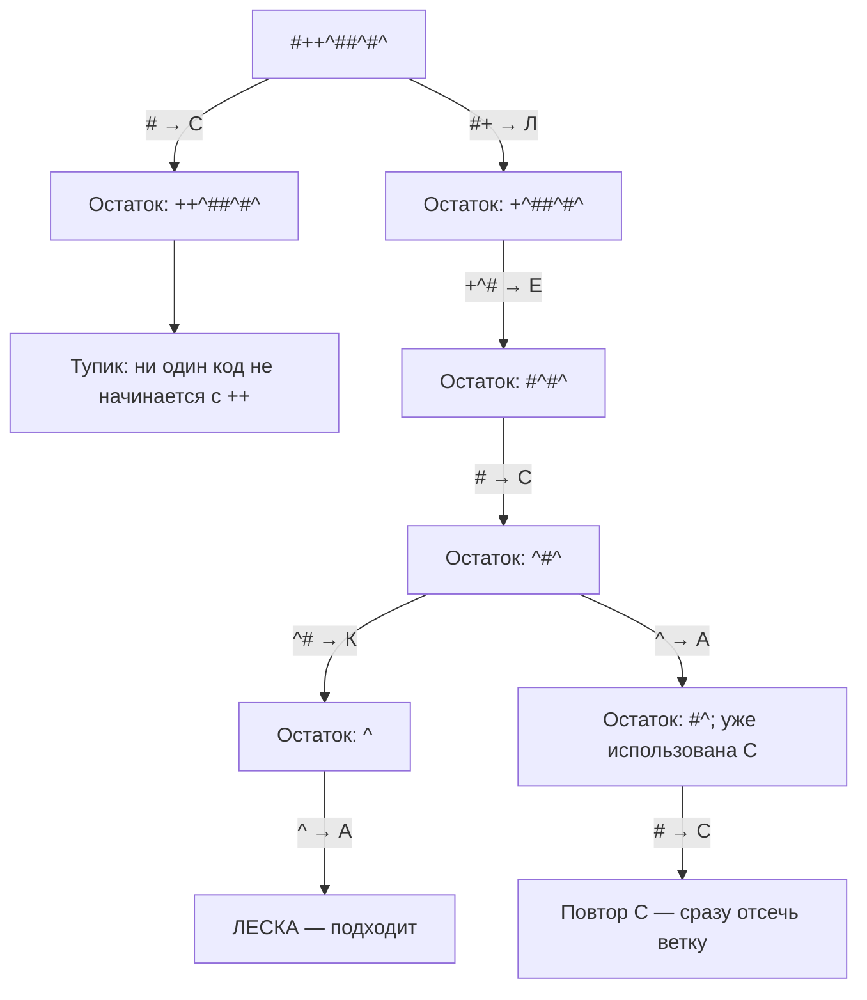
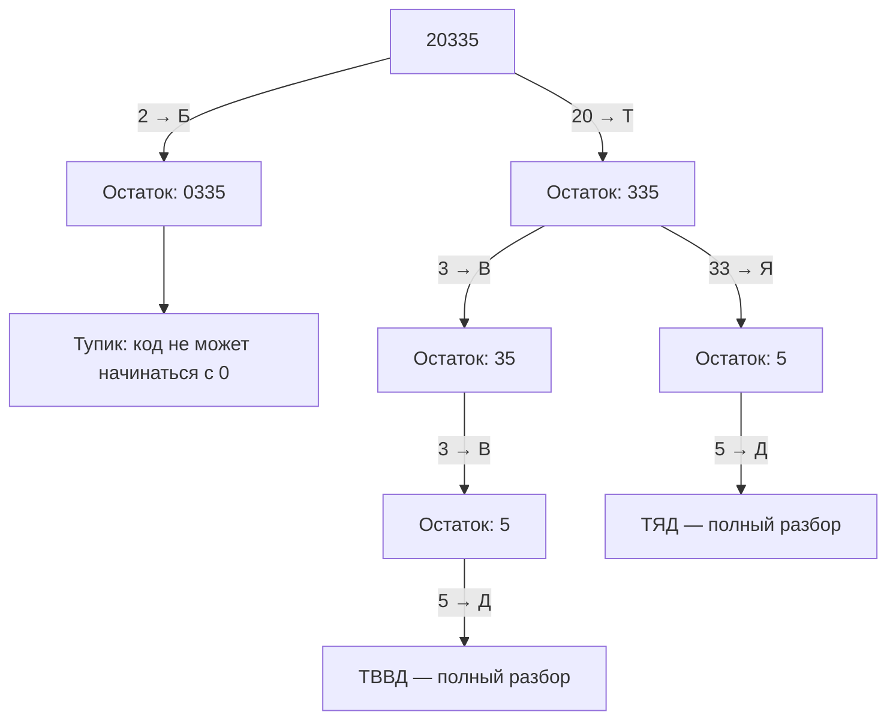
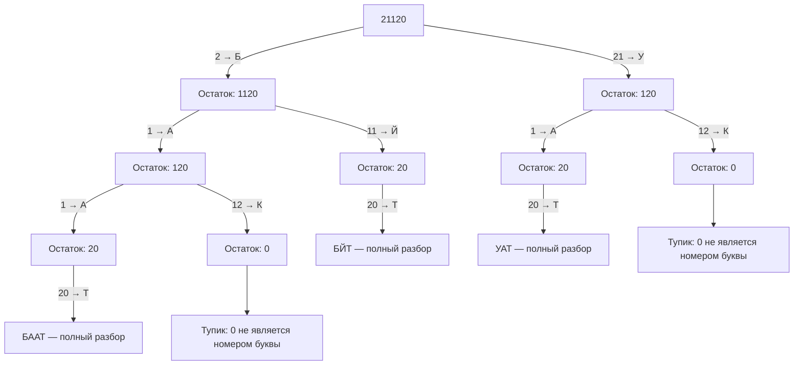
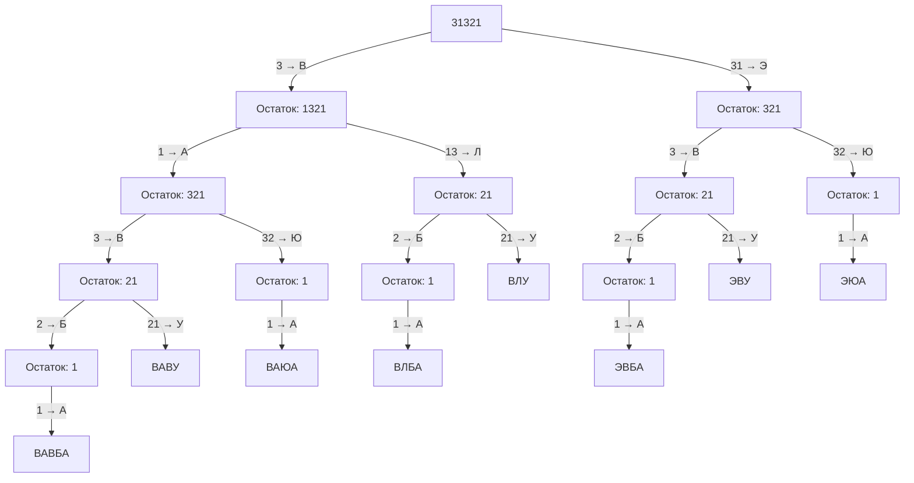
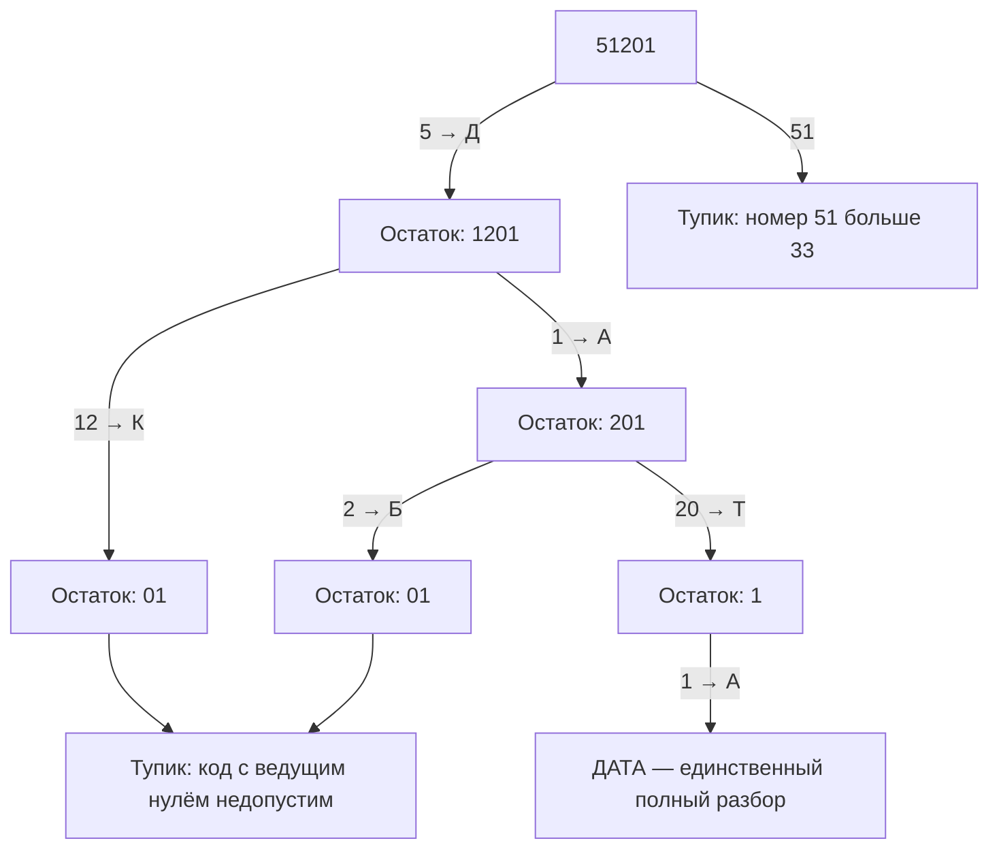

# План четвёртого занятия по информатике

**Подготовка к ОГЭ, 9 класс**  
**Группа:** «казаки», 4 ученика  
**Продолжительность:** 60 минут  
**Тема:** проверка домашнего задания по кодированию; значение логического выражения, задание 3 ОГЭ

## Материалы

- [Итоги третьего урока](../3%20урок%20(кодирование%20и%20задание%202)/Итоги_урока_3.md)
- [База знаний: задание 3](../../../../дисциплины/ОГЭ/База_знаний/03_Значение_логического_выражения/Задание_03.md)
- [Решу ОГЭ № 187](https://inf-oge.sdamgia.ru/problem?id=187) · [№ 348](https://inf-oge.sdamgia.ru/problem?id=348)

Подробный разбор домашней работы размещён в пункте 2.

## Цели занятия

1. Проверить, что ученики умеют декодировать сообщение по таблице и обосновывать единственность разбиения.
2. Познакомить группу с логическими операциями `НЕ`, `И`, `ИЛИ` в задании 3 ОГЭ.
3. Научить переводить условия с переменной в промежутки и выбирать наименьшее или наибольшее целое число.

**Ожидаемый результат:** ученик раскрывает `НЕ`, находит пересечение при `И`, объединение при `ИЛИ`, учитывает границы и объясняет выбор целого числа.

## План занятия

| Время | Блок | Содержание |
|---|---|---|
| 0–3 | Вход и цель | Коротко обозначить цель, напомнить, что домашку нужно объяснять, а не только назвать ответ |
| 3–13 | Проверка домашней работы | В парах разобрать № 187 и № 348; попросить каждого объяснить хотя бы один шаг или ветку |
| 13–18 | Разбор затруднений и переход | Исправить одну типичную ошибку; если всё верно — сформулировать, как проверяли все варианты |
| 18–26 | Введение в задание 3 | Истина и ложь; правила `НЕ`, `И`, `ИЛИ`; интервалы на числовой прямой |
| 26–36 | Совместные примеры | Решить по одному примеру на `И` с поиском наибольшего и наименьшего целого числа |
| 36–55 | Практика в парах и решение у доски | Пары решают три задачи; по одному ученику от каждой пары представляют общее решение у доски |
| 55–60 | Итог и домашнее задание | Короткая рефлексия, выдача двух задач на задание 3 |

## Ход занятия

### 1. Вход и цель (0–3 минуты)

Сказать: «Сначала проверим шифры, которые вы решали дома. Если умеем объяснить, почему других вариантов нет, двигаемся дальше — к логическим выражениям».

### 2. Проверка домашней работы (3–18 минут)

Разделить учеников на две пары. В течение первых 10 минут каждая пара разбирает одну задачу, затем кратко объясняет решение. Попросить называть не только ответ, но и причины, по которым другие ветви не подходят.

- Пара 1 разбирает № 187: таблицу кодов, варианты в начале сообщения и условие о неповторяющихся буквах.
- Пара 2 разбирает № 348: разбиения четырёх числовых строк и доказательство уникальности `51201`.

Ниже приведён подробный ключ для преподавателя. Если ученики справились, достаточно попросить их объяснить отдельные ветви, а затем перейти к заданию 3. Если возникли ошибки, выбрать одну цепочку и восстановить её вместе с группой.

#### Задача № 187. Шифр из символов

Таблица кодов:

| Буква | Ж | Е | С | А | К | Л |
|---|---|---|---|---|---|---|
| Код | `+#` | `+^#` | `#` | `^` | `^#` | `#+` |

В условии Вася и Петя кодируют сообщения собственным шифром; для решения дана эта часть кодовой таблицы. На сайте вопрос сформулирован так:

> «Расшифруйте сообщение, если известно, что буквы в нем не повторяются: `#++^##^#^`. Запишите в ответе расшифрованное сообщение.»

Полное условие: [Решу ОГЭ, задание № 187](https://inf-oge.sdamgia.ru/problem?id=187).

В начале подходят `#` = С и `#+` = Л. Если взять одиночный `#`, останется `++^##^#^`; эта ветка сразу заходит в тупик, потому что ни один код не начинается с `++`.

Если взять `#+` = Л, остаток начинается с `+^#` = Е. После этого в начале остатка подходит `#` = С. Дальше есть два варианта: `^#` = К или `^` = А. Диаграмма показывает оба пути:

Разбиение `#+ | +^# | # | ^# | ^` даёт **ЛЕСКА**. Во второй ветке после `#+ | +^# | # | ^` уже восстановлены буквы **ЛЕСА**. Следующий код `#` дал бы вторую **С**, поэтому ветку нужно отбросить сразу и не разбирать оставшийся знак `^`.

**Ответ: ЛЕСКА.**

#### Задача № 348. Шифр из чисел

В условии Вася шифрует русские слова номерами букв в алфавите, записанными подряд без пробелов. Для удобства проверки дана таблица соответствий:

| Номер | 1 | 2 | 3 | 4 | 5 | 6 | 7 | 8 | 9 | 10 | 11 | 12 | 13 | 14 | 15 | 16 | 17 | 18 | 19 | 20 | 21 | 22 | 23 | 24 | 25 | 26 | 27 | 28 | 29 | 30 | 31 | 32 | 33 |
|---|---|---|---|---|---|---|---|---|---|---|---|---|---|---|---|---|---|---|---|---|---|---|---|---|---|---|---|---|---|---|---|---|---|
| Буква | А | Б | В | Г | Д | Е | Ё | Ж | З | И | Й | К | Л | М | Н | О | П | Р | С | Т | У | Ф | Х | Ц | Ч | Ш | Щ | Ъ | Ы | Ь | Э | Ю | Я |

Даны четыре шифровки: `20335`, `21120`, `31321` и `51201`. Вопрос на сайте сформулирован так:

> «Только одна из них расшифровывается единственным способом. Найдите ее и расшифруйте. То, что получилось, запишите в качестве ответа.»

Полное условие: [Решу ОГЭ, задание № 348](https://inf-oge.sdamgia.ru/problem?id=348).

При разборе считаем допустимыми номера от 1 до 33 в обычной десятичной записи; ноль и записи с ведущим нулём не являются кодами букв.

##### Цепочка `20335`

В начале возможен код `20` = Т. Остаток `335` можно разделить как `3 | 35` нельзя, потому что 35 больше 33; допустимы ветви `3 | 3 | 5` и `33 | 5`:

Цепочка неоднозначна: **ТВВД** или **ТЯД**.

##### Цепочка `21120`

В начале подходят `2` = Б и `21` = У. После кода `2` остаток `1120` можно разобрать через `1 | 1 | 20` или `11 | 20`. После `21` остаётся `1 | 20`:

Цепочка неоднозначна: **БААТ**, **БЙТ** или **УАТ**. Опубликованный разбор приводит два варианта; при полном переборе есть также **БЙТ**.

##### Цепочка `31321`

В начале возможны `3` = В и `31` = Э. Для каждого остатка сохраняем все коды от 1 до 33, которые подходят к его началу:

Получаются восемь вариантов: **ВАВБА**, **ВАВУ**, **ВАЮА**, **ВЛБА**, **ВЛУ**, **ЭВБА**, **ЭВУ**, **ЭЮА**. Цепочка неоднозначна. На странице задания показаны примеры двух разбиений; диаграмма содержит полный перебор.

##### Цепочка `51201`

В начале `5` = Д подходит, а `51` недопустимо: такого номера буквы нет. После `5` остаётся `1201`. Ветвь `12` приводит к недопустимому остатку `01`. Если взять `1`, остаток `201` можно продолжить кодом `20`, а затем `1`:

Единственное полное разбиение — `5 | 1 | 20 | 1` → **ДАТА**. Значит, ответ задания — **ДАТА**, полученное из цепочки `51201`.

#### Сверка и переход к новому заданию (13–18 минут)

Если ученики объяснили решения, попросить их сформулировать общий алгоритм: проверять подходящие коды, продолжать каждую ветку до конца строки, отбрасывать тупики и учитывать ограничения из условия. Если нашли ошибку, восстановить одну ветку по диаграмме и дать ученикам самостоятельно объяснить итог.

### 3. Введение в задание 3 (18–26 минут)

На коротких числовых примерах напомнить:

- `НЕ` меняет условие на противоположное: `НЕ (x ≤ 15)` означает `x > 15`;
- `И` означает, что должны выполняться оба условия, поэтому оставляем пересечение промежутков;
- `ИЛИ` означает, что подходит любая из частей, поэтому берём объединение промежутков.

Показать на числовой прямой, что `x > 15` начинается с 16 среди целых чисел, а `x < 20` заканчивается на 19.

### 4. Совместные примеры (26–36 минут)

#### Пример 1. Наибольшее целое число — задание № 10638

**Условие:**

> Напишите наибольшее целое число `x`, для которого истинно высказывание:
>
> `НЕ (x ≤ 15) И (x < 20)`.

**Источник:** [задание № 10638 на Решу ОГЭ](https://inf-oge.sdamgia.ru/problem?id=10638).

**Разбор:**

1. Раскрываем отрицание: `НЕ (x ≤ 15)` означает `x > 15`.
2. Операция `И` требует, чтобы выполнялось и второе условие, поэтому получаем `15 < x < 20`.
3. Подходящие целые числа: 16, 17, 18, 19. Наибольшее из них — **19**.

#### Пример 2. Наименьшее целое число — задание № 10632

**Условие:**

> Напишите наименьшее целое число `x`, для которого истинно высказывание:
>
> `НЕ (x < 2) И (x < 5)`.

**Источник:** [задание № 10632 на Решу ОГЭ](https://inf-oge.sdamgia.ru/problem?id=10632).

**Разбор:**

1. Раскрываем отрицание: `НЕ (x < 2)` означает `x ≥ 2`.
2. Из-за `И` одновременно должно выполняться `x < 5`, значит, `2 ≤ x < 5`.
3. Подходящие целые числа: 2, 3, 4. Наименьшее из них — **2**.

Попросить учеников отметить границы промежутка и объяснить, почему крайняя точка включается или не включается.

### 5. Практика в парах и решение у доски (36–55 минут)

Разделить учеников на две пары. Каждая пара решает задания А, Б и В сообща. Попросить записывать не только ответ, но и преобразование выражения, подходящие целые числа и объяснение выбора ответа. После обсуждения один ученик от каждой пары представляет согласованное решение у доски: один объясняет преобразование условия, второй дополняет проверкой промежутка и ответа.

#### Задание А. Пересечение условий

**Условие:**

> Найдите наименьшее целое число `x`, для которого истинно высказывание `НЕ (x ≤ 3) И (x < 8)`.

**Разбор для преподавателя:** `НЕ (x ≤ 3)` означает `x > 3`. Вместе с `x < 8` получаем `3 < x < 8`; подходят 4, 5, 6, 7. Наименьшее число — **4**.

#### Задание Б. Объединение промежутков

**Условие:**

> Найдите наибольшее целое число `x`, для которого истинно высказывание `(x > 2 И x ≤ 5) ИЛИ (x ≥ 8 И x < 11)`.

**Разбор для преподавателя:** первая часть даёт числа 3, 4, 5; вторая — 8, 9, 10. Так как части соединены через `ИЛИ`, подходят числа из обеих частей. Наибольшее — **10**.

#### Задание В. Общее решение пары у доски

**Условие:**

> Найдите наибольшее целое число `x`, для которого истинно высказывание `НЕ (x < 4) И (x < 8)`.

**Разбор для преподавателя:** `НЕ (x < 4)` означает `x ≥ 4`. Вместе с `x < 8` получаем `4 ≤ x < 8`; подходят 4, 5, 6, 7. Наибольшее число — **7**.

**Организация выхода к доске:** один ученик от первой пары начинает решение задания В, второй ученик от второй пары дополняет его или проверяет границы промежутка и называет ответ. Остальные участники могут задавать уточняющие вопросы или поправить решение. Это и есть проверка результата парной работы; отдельной индивидуальной проверки нет.

Если во время практики у пары возникло затруднение, разобрать соответствующее задание у доски вместе с группой.

### 6. Итог и домашнее задание (55–60 минут)

Попросить каждого закончить одну фразу: «При `И` я…», «При `ИЛИ` я…» или «Сначала `НЕ` я…». Коротко уточнить, какое условие в заданиях оказалось сложнее и почему.

**Домашнее задание:** показать преобразования и отметить промежутки на числовой прямой.

1. **Найдите наименьшее целое число `x`, для которого истинно высказывание `НЕ (x ≤ 4) И (x < 9)`.** Покажите, как раскрыли отрицание и выбрали границы промежутка. **Ответ для преподавателя: 5.**
2. **Найдите наибольшее целое число `x`, для которого истинно высказывание `(x ≥ 1 И x ≤ 4) ИЛИ (x > 8 И x ≤ 10)`.** Отдельно выпишите числа, подходящие каждой части выражения, затем выберите наибольшее. **Ответ для преподавателя: 10.**

## На что обратить внимание

- Не переходить к новому заданию, если ученики не могут объяснить решение хотя бы одной домашней задачи.
- Не растягивать объяснение правил: после короткого примера сразу дать ученикам отметить промежуток.
- Проверять, различают ли ученики строгие и нестрогие границы: `x < a` и `x ≤ a`.
- Уточнять, что требуется найти: любое подходящее число, наименьшее или наибольшее.
