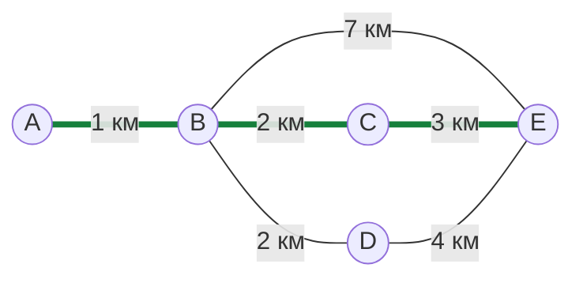
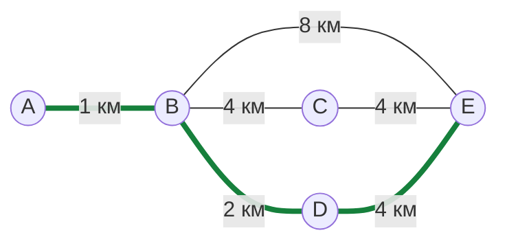
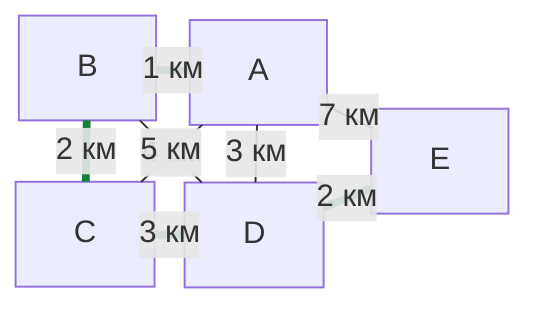

# План шестого занятия по информатике

**Подготовка к ОГЭ, 9 класс**  
**Группа:** «казаки», 4 ученика  
**Продолжительность:** 60 минут  
**Тема:** задание 4 ОГЭ — таблицы дорог и кратчайшие маршруты

## Материалы

- [Итоги пятого занятия](../5%20урок%20(повторение%20заданий%201%E2%80%933)/Итоги_урока_5.md)
- [База знаний: задание 4 — формальные описания объектов и процессов](../../../../База_знаний/04_Формальные_описания_объектов_и_процессов/Задание_04.md)
- Условия задач «Решу ОГЭ»: [№ 3](https://inf-oge.sdamgia.ru/problem?id=3), [№ 63](https://inf-oge.sdamgia.ru/problem?id=63), [№ 43351](https://inf-oge.sdamgia.ru/problem?id=43351), [№ 123](https://inf-oge.sdamgia.ru/problem?id=123)

## Цели занятия

1. Научиться читать таблицу дорог как описание графа: различать пункты, существующие дороги и их длины.
2. Находить кратчайший путь перебором подходящих маршрутов и складывать длины только существующих дорог.
3. Учитывать дополнительные условия задачи, например обязательное посещение пункта и запрет повторно посещать пункты.

## План занятия

| Время | Блок | Содержание |
|---|---|---|
| 0–5 | Обратная связь по контрольной | Коротко сообщить общий результат пятого урока, отметить удачные решения и ответить на вопросы |
| 5–12 | Модель задачи | Объяснить, что пункты — вершины графа, дороги — рёбра, числа в таблице — длины дорог, а пустая ячейка означает отсутствие дороги |
| 12–25 | Совместный разбор: [задача № 3](https://inf-oge.sdamgia.ru/problem?id=3) | Перечислить маршруты A–E, сложить длины и выбрать кратчайший. Схема с решением приведена ниже. Ответ: 6 км |
| 25–37 | Работа в парах: [задача № 63](https://inf-oge.sdamgia.ru/problem?id=63) | Пары самостоятельно перебирают маршруты, затем объясняют выбор кратчайшего. Схема с решением приведена ниже. Ответ: 7 км |
| 37–52 | Обязательный промежуточный пункт: [задача № 43351](https://inf-oge.sdamgia.ru/problem?id=43351) | Найти путь A–E через C, не посещая пункты повторно. Схема и разбор приведены ниже. Ответ: 8 км |
| 52–57 | Итоговый алгоритм | Прочитать условие и таблицу → перечислить допустимые маршруты → проверить ограничения → сложить длины → сравнить суммы |
| 57–60 | Домашнее задание | Решить [задачу № 123](https://inf-oge.sdamgia.ru/problem?id=123). Условие и таблица приведены ниже; решение на уроке не разбирается |

## Задача № 3 — кратчайший путь из A в E

**Источник:** [условие на «Решу ОГЭ», задача № 3](https://inf-oge.sdamgia.ru/problem?id=3).

**Условие.** Определите длину кратчайшего пути между пунктами A и E. Передвигаться можно только по дорогам, протяжённость которых указана в таблице.

|   | A | B | C | D | E |
|---|---:|---:|---:|---:|---:|
| A | — | 1 | — | — | — |
| B | 1 | — | 2 | 2 | 7 |
| C | — | 2 | — | — | 3 |
| D | — | 2 | — | — | 4 |
| E | — | 7 | 3 | 4 | — |

**Граф и решение.** Перечисляем варианты: A–B–C–E = 1 + 2 + 3 = 6 км; A–B–D–E = 1 + 2 + 4 = 7 км; A–B–E = 1 + 7 = 8 км. Самый короткий маршрут — A–B–C–E, его длина **6 км**.

Зелёным выделен кратчайший путь A–B–C–E.

## Задача № 63 — кратчайший путь из A в E

**Источник:** [условие на «Решу ОГЭ», задача № 63](https://inf-oge.sdamgia.ru/problem?id=63).

**Условие.** Определите длину кратчайшего пути между пунктами A и E. Передвигаться можно только по дорогам, протяжённость которых указана в таблице.

|   | A | B | C | D | E |
|---|---:|---:|---:|---:|---:|
| A | — | 1 | — | — | — |
| B | 1 | — | 4 | 2 | 8 |
| C | — | 4 | — | — | 4 |
| D | — | 2 | — | — | 4 |
| E | — | 8 | 4 | 4 | — |

**Граф и решение.** Сравниваем варианты: A–B–C–E = 1 + 4 + 4 = 9 км; A–B–E = 1 + 8 = 9 км; A–B–D–E = 1 + 2 + 4 = 7 км. Самый короткий маршрут — A–B–D–E, его длина **7 км**.

Зелёным выделен кратчайший путь A–B–D–E.

## Задача № 43351 — путь через обязательный пункт C

**Источник:** [условие на «Решу ОГЭ», задача № 43351](https://inf-oge.sdamgia.ru/problem?id=43351).

**Условие.** Найдите кратчайший путь из A в E через пункт C, используя только дороги из таблицы. Каждый пункт можно посетить только один раз.

|   | A | B | C | D | E |
|---|---:|---:|---:|---:|---:|
| A | — | 1 | 4 | 3 | 7 |
| B | 1 | — | 2 | 5 | — |
| C | 4 | 2 | — | 3 | — |
| D | 3 | 5 | 3 | — | 2 |
| E | 7 | — | — | 2 | — |

**Граф и решение.** Оставляем только маршруты, проходящие через C и не содержащие повторных пунктов. A–B–C–D–E = 1 + 2 + 3 + 2 = 8 км; A–C–D–E = 4 + 3 + 2 = 9 км; A–C–B–D–E = 4 + 2 + 5 + 2 = 13 км. Кратчайший путь — A–B–C–D–E, его длина **8 км**.

Зелёным выделен кратчайший допустимый путь A–B–C–D–E: 1 + 2 + 3 + 2 = **8 км**.

## Домашнее задание — задача № 123

**Источник:** [условие на «Решу ОГЭ», задача № 123](https://inf-oge.sdamgia.ru/problem?id=123).

**Условие.** Определите длину кратчайшего пути между пунктами A и E. Передвигаться можно только по дорогам, протяжённость которых указана в таблице.

|   | A | B | C | D | E |
|---|---:|---:|---:|---:|---:|
| A | — | 3 | — | — | — |
| B | 3 | — | 1 | 2 | 6 |
| C | — | 1 | — | — | 3 |
| D | — | 2 | — | — | 3 |
| E | — | 6 | 3 | 3 | — |

На дом: перечислить допустимые маршруты, записать длину каждого и указать кратчайший путь. Ответ и граф в условие для учеников не включены.

## Подсказки для преподавателя

- Пустая ячейка означает, что дороги нет; учитывать можно только указанные длины.
- Для обычной дороги проверять, что длина между двумя пунктами указана симметрично.
- При обязательном промежуточном пункте оставлять только маршруты, которые через него проходят.
- При запрете повторов исключать маршрут, если в нём пункт встречается более одного раза.
- В ответе указывать длину пути, а записанный маршрут использовать для обоснования суммы.
