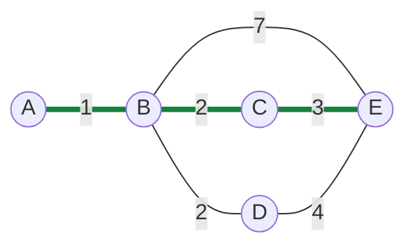
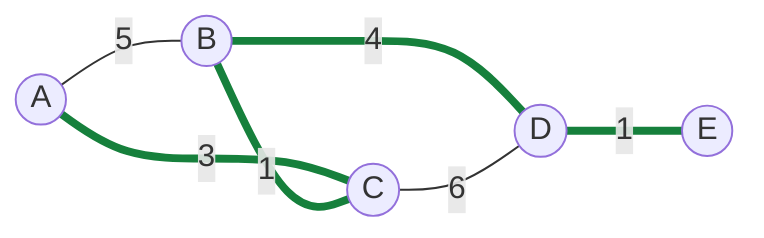
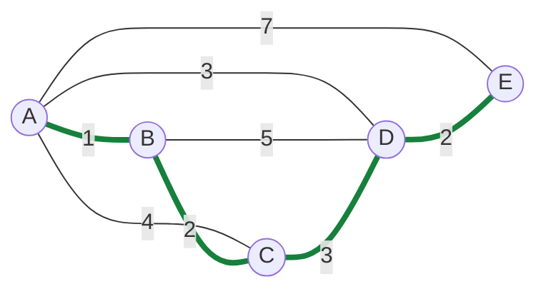

# Задание 4. Формальные описания реальных объектов и процессов

## Краткая теория

Таблица описывает дороги между пунктами: число на пересечении строки и столбца — длина дороги, пустая ячейка означает отсутствие прямой дороги. Длину маршрута получают сложением длин дорог, по которым он проходит.

Найди допустимые маршруты и сравни их длины. Дополнительные ограничения, например обязательный промежуточный пункт или запрет повторного посещения, нужно проверять для всего маршрута. Две отдельно кратчайшие части пути могут иметь общий пункт и вместе нарушить такой запрет.

## [Анализ схемы](https://inf-oge.sdamgia.ru/test?theme=39)

В актуальной выгрузке каталога раздел пуст: примеры для него отсутствуют.

## [Анализ таблицы](https://inf-oge.sdamgia.ru/test?theme=3)

Используй таблицу дорог и учитывай ограничения на маршрут. В последнем примере путь обязан проходить через указанный пункт.

**Пример задания** ([№ 3](https://inf-oge.sdamgia.ru/problem?id=3))

>**Условие**

Между населенными пунктами А, В, С, D, Е построены дороги, протяженность которых (в километрах) приведена в таблице:

|  | A | B | C | D | E |
| --- | --- | --- | --- | --- | --- |
| A |  | 1 |  |  |  |
| B | 1 |  | 2 | 2 | 7 |
| C |  | 2 |  |  | 3 |
| D |  | 2 |  |  | 4 |
| E |  | 7 | 3 | 4 |  |

Определите длину кратчайшего пути между пунктами А и E. Передвигаться можно только по дорогам, протяженность которых указана в таблице.

>**Решение**

Найдем все варианты маршрутов из A в E и выберем самый короткий.

Из пункта A можно попасть в пункт B.

Из пункта B можно попасть в пункты C, D, E.

Из пункта C можно попасть в пункт E.

Из пункта D можно попасть в пункт E.

A—B: длина маршрута 1 км.

A—B—C—E: длина маршрута 6 км.

A—B—D—E: длина маршрута 7 км.

A—B—E: длина маршрута 8 км.

Самый короткий путь: A—B—C—E. Длина маршрута 6 км.

Ответ: 6.

**Схема к примеру:** зелёным выделен кратчайший маршрут.

---

**Пример задания** ([№ 23](https://inf-oge.sdamgia.ru/problem?id=23))

>**Условие**

Между населенными пунктами А, В, С, D, Е построены дороги, протяженность которых (в километрах) приведена в таблице:

|  | A | B | C | D | E |
| --- | --- | --- | --- | --- | --- |
| A |  | 5 | 3 |  |  |
| B | 5 |  | 1 | 4 |  |
| C | 3 | 1 |  | 6 |  |
| D |  | 4 | 6 |  | 1 |
| E |  |  |  | 1 |  |

Определите длину кратчайшего пути между пунктами А и E. Передвигаться можно только по дорогам, протяженность которых указана в таблице.

>**Решение**

Найдем все варианты маршрутов из A в E и выберем самый короткий.

Из пункта A можно попасть в пункты B, С.

Из пункта B можно попасть в пункты C, D.

Из пункта C можно попасть в пункты B, D.

Из пункта D можно попасть в пункт E.

A−B−C−D−E: длина маршрута 13 км.

A−B−D−E: длина маршрута 10 км.

A−C−D−E: длина маршрута 10 км.

A−C−B−D−E: длина маршрута 9 км.

Самый короткий путь: A−C−B−D−E. Длина маршрута 9 км.

Ответ: 9.

**Схема к примеру:** зелёным выделен кратчайший маршрут.

---

**Пример задания** ([№ 43351](https://inf-oge.sdamgia.ru/problem?id=43351))

>**Условие**

Между населенными пунктами A, B, C, D, E построены дороги, протяженность которых (в километрах) приведена в таблице.

|  | A | B | C | D | E |
| --- | --- | --- | --- | --- | --- |
| A |  | 1 | 4 | 3 | 7 |
| B | 1 |  | 2 | 5 |  |
| C | 4 | 2 |  | 3 |  |
| D | 3 | 5 | 3 |  | 2 |
| E | 7 |  |  | 2 |  |

Определите длину кратчайшего пути между пунктами A и E, проходящего через пункт C. Передвигаться можно только по дорогам, протяженность которых указана в таблице. Каждый пункт можно посетить только один раз.

>**Решение**

Найдем все варианты маршрутов из A в E, проходящих через C, и выберем самый короткий.

Из пункта A можно попасть в пункт B, C, D, E.

Из пункта B можно попасть в пункты C, D.

Из пункта C можно попасть в пункт D.

Из пункта D можно попасть в пункт E.

A—B—C—D—E: длина маршрута 8 км.

A—C—D—E: длина маршрута 9 км.

Самый короткий путь: A—B—C—D—E. Длина маршрута 8 км.

Ответ: 8.

**Дополнение:** в приведённом решении не перечислен допустимый маршрут A—C—B—D—E длиной 4 + 2 + 5 + 2 = 13 км. Он длиннее указанного кратчайшего маршрута и не меняет ответ.

**Схема к примеру:** зелёным выделен кратчайший маршрут через C.

---

## Решения с помощью кода

Для небольших графов маршруты можно перебрать программой: [TypeScript](Решение_кодом/Решение.ts). [Анимация обхода графов](Решение_кодом/Обход_графов.html) показывает пошаговый перебор для нескольких примеров.
